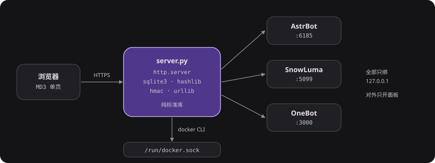

# bot-panel

[](https://github.com/SelkieLab/bot-panel/actions/workflows/ci.yml)
[](https://github.com/SelkieLab/bot-panel/blob/main/LICENSE)
[](https://www.python.org)
[](#快速开始)

AstrBot + SnowLuma 的单文件控制面板。纯 Python 标准库，零第三方依赖。

容器状态、实时日志、插件市场、人格提示词、QQ 扫码登录、知识库，
全在一个网页里。前端是 MD3 风格的单页应用，手机能用，离线有兜底。

```
不装 node_modules    不打包    不连数据库服务    不需要注册任何账号
```



```
server.py        # 全部后端逻辑（HTTP 服务 + 上游代理 + TOTP + 审计），一个文件
qqrefresh.py     # 容器内 X11 点击脚本，用来点 QQ 的「刷新二维码」
static/          # 前端：index.html + partials/ 分片 + js/ + css/
deploy/          # systemd 单元、备份脚本、compose 文件、证书工具
personas.example.json  # 人格模板库示例（真实人设放 personas.json，已在 .gitignore）
docs/            # 改造记录与运维笔记
```

---

## 目录

- [能力](#能力)
- [快速开始](#快速开始)
- [环境变量](#环境变量)
- [部署](#部署systemd)
- [安全模型](#安全模型)
- [已知限制](#已知限制)
- [文档](#文档)
- [许可](#许可)

---

## 能力

| 模块 | 做了什么 |
|---|---|
| 概览 | 容器/服务状态、CPU/内存、机器人连接信息、主人 QQ |
| 日志 | `docker logs --follow` 经 SSE 逐行推送，断线自动重连，可按容器/级别过滤 |
| 插件 | AstrBot 官方市场（约 2700 个插件）分页/分类/排序、安装、卸载、更新、按 schema 渲染配置表单 |
| 人格 | 模板库 → 一键建成 AstrBot 人格；支持设为默认（触发重启） |
| 桌面 | 实时截屏 + 鼠标点击（noVNC 兜底），用于 QQ 扫码登录 |
| 学习 | 文档上传 → 转文本 → 建知识库 → 检索测试（需要 embedding 模型） |
| 账户 | 密码（PBKDF2）、TOTP 两步验证、会话失效、审计日志、告警（QQ / webhook） |

---

## 快速开始

### 1. 依赖

* Python 3.8+（只用标准库）
* Docker（面板通过 `docker` CLI 控制容器，服务用户需在 `docker` 组里）
* 上游：一个 AstrBot 容器 + 一个 SnowLuma 容器（见 `deploy/docker-compose.yml`）

### 2. 启动

```bash
git clone https://github.com/SelkieLab/bot-panel.git
cd bot-panel
PANEL_INIT_PASSWORD='换成你自己的密码' python3 server.py
```

首次启动会打印一行初始密码（或使用 `PANEL_INIT_PASSWORD`），同时生成
`config.json`（权限 0600）。默认监听 `0.0.0.0:16666`。

### 3. 填上游账号

打开面板 → 设置 → 上游服务，填 AstrBot / SnowLuma 的账号密码和管理地址。
也可以直接用环境变量注入，见下表。

人格模板库：把 `personas.example.json` 复制成 `personas.json` 再改，
面板「人格」页的模板列表就来自这个文件（该文件默认不进仓库，避免把私人设定推到公开）。

### 4. 上 HTTPS（强烈建议）

面板本身支持直接加载证书（`tls.enabled`），也可以放在 Nginx / Caddy 后面。
裸 HTTP 暴露在公网等于把密码明文发出去。

---

## 环境变量

| 变量 | 默认 | 说明 |
|---|---|---|
| `PANEL_PORT` | `16666` | 监听端口 |
| `PANEL_INIT_PASSWORD` | 随机 | 首次启动的初始密码 |
| `PANEL_CONFIG` | `./config.json` | 配置文件路径 |
| `PANEL_PERSONAS` | `./personas.json` | 人格模板库路径 |
| `PANEL_PUBLIC_HOST` | 自动探测 | 对外访问地址（用于展示链接） |
| `ASTRBOT_BASE` / `ASTRBOT_USER` / `ASTRBOT_PASSWORD` | `http://127.0.0.1:6185` / `astrbot` / 空 | AstrBot WebUI |
| `SNOWLUMA_BASE` / `SNOWLUMA_USER` / `SNOWLUMA_PASSWORD` | `http://127.0.0.1:5099` / `admin` / 空 | SnowLuma WebUI |
| `ONEBOT_BASE` / `ONEBOT_TOKEN` | `http://127.0.0.1:3000` / 空 | OneBot HTTP 接口 |
| `ASTRBOT_CONTAINER` / `SNOWLUMA_CONTAINER` | `astrbot` / `snowluma` | 容器名 |
| `ASTRBOT_DATA` | `/opt/bots/astrbot/data` | AstrBot 数据目录（只读挂载点） |

仓库里不含任何真实口令：所有密码来自环境变量或首次启动后的 `config.json`。

---

## 部署（systemd）

```bash
sudo install -m644 deploy/systemd/bot-panel.service /etc/systemd/system/
sudo systemctl daemon-reload && sudo systemctl enable --now bot-panel
```

单元文件已按"非特权用户 + 只读文件系统 + 最小 syscall 集合"写好，
需要按自己的路径调整 `ReadWritePaths`。要点：

* 服务用户必须在 `docker` 组
* `ProtectSystem=strict` 下必须显式放行 `/run/docker.sock` 和面板目录
* TLS 私钥设成 `640` 且组可读，否则降权后读不到

备份用 `deploy/bin/backup.sh` + `bot-backup.timer`：只备不可再生数据
（AstrBot 数据库/插件/配置、QQ 登录态、面板自身），sqlite 走在线 `.backup`。

---

## 安全模型

* 面板口令 **PBKDF2-SHA256**（12 万轮，独立盐）；改密后 `pwv` 递增，旧会话立即失效
* 可选 **TOTP** 两步验证（RFC 6238，已用官方向量验证）
* 登录失败有按 IP 与全局双维度限流
* 所有敏感操作写 `audit.log`（JSON Lines，0600，logrotate）
* 静态资源走内容哈希 URL + `immutable` 一年；API 一律 `no-store`
* 路径穿越在校验层拦截（`..`、绝对路径、后缀白名单）
* systemd 沙箱：`NoNewPrivileges` / `MemoryDenyWriteExecute` / `CapabilityBoundingSet=` 等

**不做什么**：面板不存 QQ 号密码，不代理任意 URL，不允许重启白名单外的容器。

---

## 已知限制

* 概览页的服务快捷入口里端口是写死的（`16185` / `15099`），
  只对特定部署形态有意义，按自己的反代端口改 `static/js/app.js`
* 知识库需要 OpenAI 兼容的 **embedding** 接口；只有对话模型建不了库（会明确提示，不会假成功）
* `qqrefresh.py` 依赖容器内 X11（`:1`）与固定的点击坐标，分辨率变了要调

## 文档

| 文档 | 内容 |
|---|---|
| [docs/DEPLOY.md](docs/DEPLOY.md) | 从干净 Ubuntu 到外网可访问，含无域名方案与排障表 |
| [docs/ARCHITECTURE.md](docs/ARCHITECTURE.md) | 请求怎么走、为什么是单文件、缓存策略、数据落点 |
| [docs/CHANGELOG-2026-10-23.md](docs/CHANGELOG-2026-10-23.md) | 首个版本之前的 11 项改造记录 |
| [CHANGELOG.md](CHANGELOG.md) | 版本更新日志 |
| [SECURITY.md](SECURITY.md) | 攻击面清单与部署硬性要求 |

## 参与

提 issue 前先看 [贡献指南](https://github.com/SelkieLab/.github/blob/main/CONTRIBUTING.md)。
安全问题按 [SECURITY.md](SECURITY.md) 私下报告。

## 许可

MIT，见 [LICENSE](LICENSE)。
